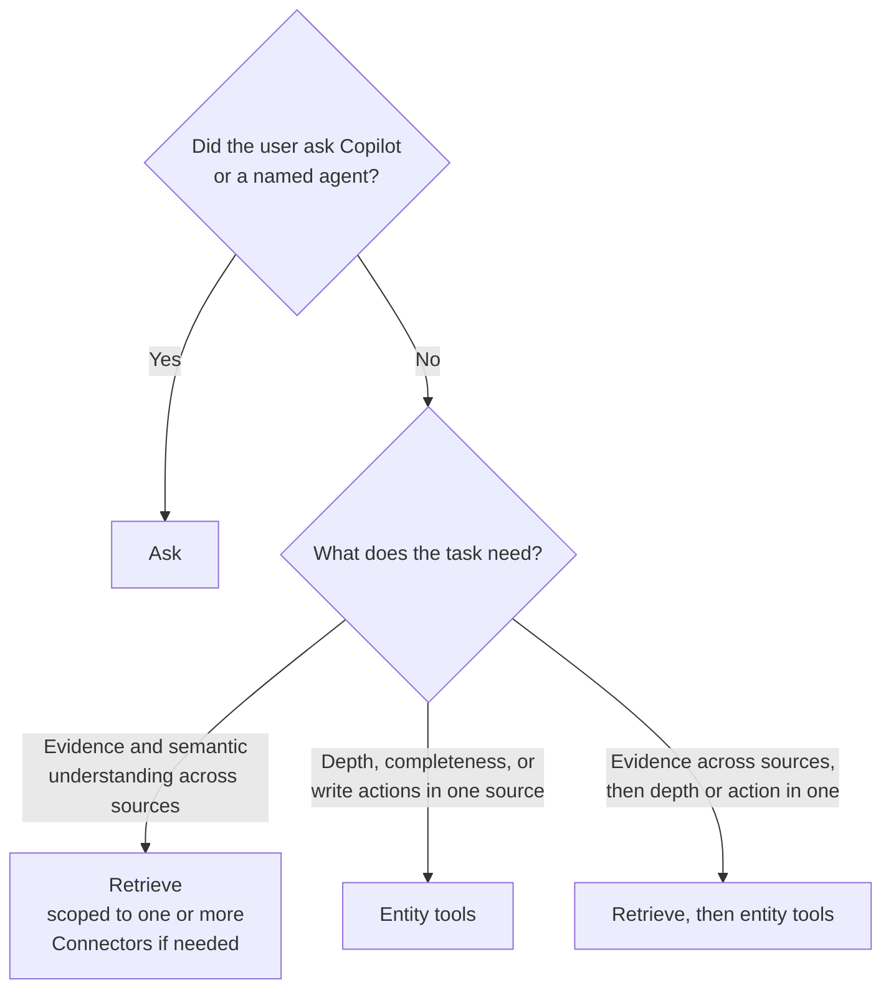

# Using Connectors with Work IQ: when to use what, and how

Connectors let agents work with data in third-party and line-of-business
systems, such as Jira, ServiceNow, HubSpot, Slack, Intercom, and many others,
alongside Microsoft 365. Agents use them through three Work IQ capabilities:
Ask, Retrieve, and entity tools (`search_paths`, `get_schema`,
`call_function`, `do_action`, and others). The examples in this guide use a
few well-known systems, but the same guidance applies to any connected system.

## When to use what

Work IQ gives agents access to more than 400 Connectors to enterprise systems.
Some of the popular Connectors include:
- **Files and knowledge:** Google Drive, intranet sites, ServiceNow KB, Notion
- **Communication, meetings, and people:** Slack, Zoom, Workday
- **Developer tools:** Jira Cloud, GitHub, Confluence Cloud, Azure DevOps
- **Financial services:** LSEG, Moody's, S&P Global
- **CRM and customer support:** Salesforce, HubSpot, Intercom
- **Legal:** iManage, NetDocuments, LexisNexis, Harvey
- **Accounting:** Xero, Aiwyn Tax, SAP S/4HANA
- **Healthcare and life sciences:** PubMed, ClinicalTrials.gov
- **Small business:** Shopify, Intuit QuickBooks, Stripe

Any Connector that's already connected in a Copilot surface is available
through Work IQ, with no extra setup. Agents can list all available
Connectors, and the ones that are connected, with `<placeholder API>`.
Connected sources take part in Ask and Retrieve, and their operations are
available through entity tools.

The same rules apply whether the data lives in Microsoft 365 or in a
Connector. What matters is what the task needs.

### 1. Use Ask to delegate a question to Copilot or another agent

Use Ask when the user explicitly requests an answer from Copilot or a named
agent. Copilot handles reasoning across Microsoft 365 and connected systems.
For example, it can combine Slack threads, CRM deal notes, Outlook mail, and
other sources into one answer. Ask returns an answer, which the calling agent
passes on as the other agent's work. Ask can be scoped to one or more
Connectors and Microsoft 365 sources.

### 2. Use Retrieve to gather relevant evidence and context across sources

Use Retrieve for semantic understanding across Microsoft 365 and connected
systems. It returns relevant, token-efficient excerpts with citations,
allowing agents to reason over information without retrieving entire records.
Ideal for investigations, summaries, comparisons, and catch-up scenarios,
especially when information spans multiple systems or its location is
unknown. For example, agents can combine ServiceNow KB articles, Jira issues,
Intercom conversations, Slack messages, and Outlook emails to investigate a
customer escalation. Retrieve supports scoping to specific Connectors and
Microsoft 365 sources.

### 3. Use entity tools for precise, complete data access and actions for a specific connected system

Use entity tools when the task requires full records, structured queries, or
actions in a specific connected system. You can find the right Connector
tools and their supported operations with `search_paths`, check the input
schema for the operation with `get_schema`, and then execute the operation.

Entity tools provide depth and completeness. Use entity tools to:
- Get full records, with all their fields, history, and related items.
- Get every record that matches field filters, or a count of them.
- Make changes, such as creating, updating, or transitioning a record.

For example, use entity tools to get a deal's complete activity history from
a CRM such as Salesforce or HubSpot, list every open P1 issue in a tracker
such as Jira, or update a ticket in a service desk such as ServiceNow.

### 4. Combine Retrieve and entity tools for cross-source understanding and deeper investigation or action

Use Retrieve to gather relevant evidence across systems, then entity tools to
inspect complete records or take actions. Agents can iterate between the two
as new questions emerge.

Common scenarios include:
- **Pipeline review:** Use Retrieve to analyze CRM notes, emails, and support
  history; entity tools to inspect at-risk deals and update next steps.
- **Escalation investigation:** Use Retrieve to correlate Slack discussions,
  support conversations, and KB articles; entity tools to create a Jira issue
  with the findings.
- **Ticket triage:** Use Retrieve to identify related incidents and known
  fixes; entity tools to update the ServiceNow ticket with the resolution.



### Examples

**Ask**

| Prompt | Connectors | How |
| --- | --- | --- |
| "Ask Copilot what changed on the Contoso account this week." | All connected, such as Salesforce, Slack, and Intercom | Ask Copilot, no scoping |
| "Ask Copilot what Confluence and Jira say about the Q3 release plan." | Confluence Cloud, Jira Cloud | Ask Copilot, scoped to those Connectors |
| "Ask Copilot what Moody's and S&P Global say about Northwind's credit outlook." | Moody's, S&P Global | Ask Copilot, scoped to those Connectors |
| "Ask the Legal Research agent how recent rulings affect our NDA template." | LexisNexis, iManage | Ask the named agent |
| "Ask that same agent whether those rulings apply to the Fabrikam contract." | LexisNexis, iManage | Ask, continuing the same conversation |

**Retrieve**

| Prompt | Connectors | How |
| --- | --- | --- |
| "Investigate the Contoso escalation and prepare a response plan." | ServiceNow KB, Jira Cloud, Intercom, Slack, plus Microsoft 365 | Retrieve, no scoping |
| "What does our ServiceNow KB say about VPN certificate errors?" | ServiceNow KB | Retrieve, scoped to ServiceNow KB |
| "Catch me up on the Atlas launch from Slack, Zoom meetings, and Confluence." | Slack, Zoom, Confluence Cloud | Retrieve, scoped to those Connectors |
| "Compare the onboarding redesign proposals in Google Drive and Notion." | Google Drive, Notion | Retrieve, scoped to those Connectors |
| "Find recent studies and active trials on GLP-1 drugs for heart failure." | PubMed, ClinicalTrials.gov | Retrieve, scoped to those Connectors |

**Entity tools**

| Prompt | Connectors | How |
| --- | --- | --- |
| "Show the full activity history of the Fabrikam deal in Salesforce." | Salesforce | Read the full record |
| "List all open P1 issues in Jira project TEL." | Jira Cloud | Query every matching record |
| "How many Shopify orders are still unfulfilled this week?" | Shopify | Count matching records |
| "Create a GitHub issue for the login timeout bug and assign it to Priya." | GitHub | Create a record, after the user confirms |
| "Mark invoice INV-2041 as paid in QuickBooks." | Intuit QuickBooks | Update a record, after the user confirms |

**Retrieve, then entity tools**

| Prompt | Connectors | How |
| --- | --- | --- |
| "Prepare the Q4 pipeline review and update next steps where they're clear." | HubSpot, Intercom, plus Microsoft 365 | Retrieve the evidence, then read and update each deal in HubSpot |
| "Investigate the checkout outage and file a Jira issue with the findings." | Slack, Intercom, ServiceNow KB, Jira Cloud | Retrieve the evidence, then create the issue in Jira |
| "Triage incident INC-4421 using similar incidents and known fixes, then update it." | ServiceNow KB, ServiceNow | Retrieve related incidents and fixes, then update the ticket in ServiceNow |
| "Find our matters affected by the new data privacy ruling and flag them in iManage." | LexisNexis, iManage | Retrieve the ruling and affected matters, then update the matters in iManage |
| "Review vendor disputes from email and Slack, then put the matching Xero bills on hold." | Slack, Xero, plus Microsoft 365 | Retrieve the disputes, then read and update each bill in Xero |

**Common mistakes to avoid:**
- Calling Ask to gather information the agent will reason over itself.
- Sending Retrieve results to Ask to be summarized again.
- Calling Ask automatically when Retrieve is unavailable, fails, or comes back
  empty. Offer Ask to the user as an option instead.
- Calling Retrieve or listing agents before an "Ask Copilot..." request. Call
  Ask directly.
- Treating Ask's answer as proof that something was done. Changes are made
  with entity tools.
- Using Retrieve to get complete lists or record IDs for updates.
- Making many entity tool calls to imitate a search.
- Switching between Ask and Retrieve on your own after an error, an empty
  result, or a sign-in prompt.

## How to use them

### Scoping

By default, don't scope. Without a scope, Ask and Retrieve use all the
sources they can reach. A topic such as "Contoso deals" isn't a reason to
scope.

Scope only in these cases:
- The user names a source, such as "check Slack and the Outlook thread".
- The task has a clear boundary, such as "support tickets only".
- The agent is filling one specific gap, such as the status of one Jira issue.

When you scope, include every source the user named, including Microsoft 365
sources such as Outlook or Teams.

To scope to a Connector, the agent needs its ID. To get it, call
`search_paths`, then call `fetch` to list the user's connected Connectors. Use
only IDs returned this way, and never guess an ID from a name. If the
Connector the user named isn't connected, tell the user.

### Retrieve

Always set `strategy` explicitly. Use `copilot` when the request needs
evidence from a Connector, including requests that also need Microsoft 365
content. Otherwise use `grounding`, which is the default for ordinary or
unspecified sources. Don't choose `copilot` just because you don't know where
the information is. Retrieve with `copilot` still returns evidence; it isn't
Ask.

To scope, list the sources in `capabilities`. Connectors go under
`GraphConnectors`, and Microsoft 365 sources use their own names, such as
`Email`.

*"Investigate the Contoso escalation using Intercom support history and
customer emails."*

```json
{
  "query": ["Contoso escalation timeline: support issues and customer communications"],
  "strategy": "copilot",
  "capabilities": [
    { "name": "GraphConnectors", "connections": [ { "connection_id": "<intercom-id>" } ] },
    { "name": "Email" }
  ]
}
```

Inside a Connector, you can narrow to a container, path, or item.

*"What does the IT-Network ServiceNow KB say about VPN certificate errors?"*

```json
{
  "query": ["VPN certificate error troubleshooting steps"],
  "strategy": "copilot",
  "capabilities": [
    { "name": "GraphConnectors", "connections": [
      { "connection_id": "<servicenow-id>", "items_by_container_name": [ { "container_name": "IT-Network" } ] }
    ] }
  ]
}
```

### Ask

Use Ask only for a request the user has handed to Copilot or a named agent.
Don't call Retrieve or `list_agents` first for an "Ask Copilot..." request.
Leave out `agentId` to use Copilot.

Scope Ask only when the user's request names sources. To limit which
Connectors Ask uses, set `dataSources.connectorIds`:
- Leave `dataSources` out to use all of the user's Connectors.
- Pass an empty list to use no Connectors.
- Pass IDs to use only those Connectors.

`dataSources` doesn't limit Microsoft 365 content. To focus on a Microsoft 365
source, name it in the question. Never send Retrieve parameters such as
`query`, `strategy`, or `capabilities` to Ask.

*"Ask Copilot whether we committed to moving the Contoso launch to Nov 15.
Have it check the internal Slack discussion and the latest Outlook thread with
the customer."*

```json
{
  "question": "Using our internal Slack discussion and the latest Outlook thread with Contoso, did we commit to moving the launch to November 15? Cite both.",
  "dataSources": { "connectorIds": ["<slack-id>"] }
}
```

To point Ask at specific items, use `resources` for Connector records or
`fileUrls` for OneDrive and SharePoint files. Don't widen a request about one
item into a broad search.

*"Ask Copilot whether ServiceNow ticket SNW-4421 was resolved within SLA."*

```json
{
  "question": "Was this ticket resolved within our SLA?",
  "resources": [ { "external": { "itemId": "SNW-4421", "contentSource": "ServiceNow" } } ]
}
```

To use a named agent, pass its exact `agentId`. Reuse an ID you already have,
or look it up with `list_agents`. Never guess an ID. If the agent can't be
found or the match is unclear, stop or ask the user to choose; don't quietly
use Copilot instead. For a follow-up to the same agent, pass the
`conversationId` from its previous answer. Don't reuse that ID with a
different agent or for an unrelated task.

*"Ask the Sales Insights agent which Q4 deals are at risk."*

```json
{ "question": "Which Q4 deals are at risk and why?", "agentId": "<id from list_agents>" }
```

Present the answer as that agent's answer and keep its citations. Don't
claim you checked the sources yourself. If Ask fails, don't switch to Retrieve
on your own. Explain the alternative and let the user decide. If the user also
asked for a change, such as updating a record, Ask's answer doesn't make the
change; use entity tools after the user confirms.

### Entity tools

Connector operations appear in `search_paths` results next to Microsoft 365
paths. To use one:
1. Find the right tools and their supported operations with `search_paths`,
   such as "HubSpot deals by close date".
2. Check the input schema for the operation with `get_schema`.
3. Read with `call_function`.
4. Write with `do_action`, but only after the user confirms the exact change.
5. If a sign-in is required, show it to the user. When they've signed in,
   make the same call again.

*"Review Q4 strategic deals in HubSpot, find ones with no next step, and
update the next step where it's clear."* The agent finds the HubSpot search and
update operations with `search_paths`. It reads the deals with
`call_function` and proposes updates. After the user confirms the updates, it
makes them with `do_action`.

## Open questions

1. **Connector ID lookup isn't available yet.** Agents can't get Connector IDs
   through Work IQ today. Until they can, should agents skip scoping, or name
   the source in the question or query?
2. **Ask and Retrieve use different IDs.** Ask uses `connectorIds` and Retrieve
   uses `connection_id`. Can one ID work for both?
3. **Ask and Retrieve scope differently.** Retrieve can scope Microsoft 365
   sources, but Ask can scope only Connectors. Should Ask match Retrieve, like
   the source picker in Copilot Chat?
4. **Federated Connectors in Retrieve.** How are they scoped in
   `capabilities`? Does the `grounding` strategy support Connectors?
5. **Default Retrieve strategy.** The skill defaults to `grounding`, which
   doesn't include Connectors. Should the default change to `copilot` when the
   user has Connectors?
6. **Unavailable Connectors.** Ask quietly drops Connector IDs that aren't
   connected or that the user can't access. Should it tell the agent which IDs
   it dropped?
7. **Named agents.** Does Ask scoping work when the call targets a specific
   agent? Retrieve doesn't allow scoping in that case.
8. **Availability.** When will Ask scoping and Connector entity tools reach tenants
   that use third-party agent hosts?
9. **The two skills choose Ask differently.** This guide follows
   `workiq-preview`: use Retrieve by default and Ask only when the user hands
   the question off. The public `workiq` skill does the opposite and prefers
   Ask for summaries and reasoning. Should both skills follow the same rule?
   And should hosts that only display an answer, such as a Copilot bot in
   Slack, be treated as handing off by default?
